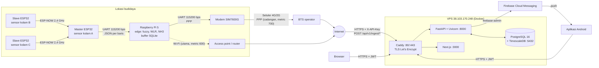

# KrabCare: Cara Kerja dan Arsitektur Jaringan End-to-End

Dokumen ini menjelaskan perjalanan data KrabCare dari sensor di kolam sampai tampil di web dan aplikasi mobile, beserta jaringan, protokol, alamat, dan mekanisme keandalan di setiap segmennya. Isinya disusun dari kode yang berjalan (`raspi/`, `backend/`, `web/`, `mobile/`, Docker Compose, Caddyfile) dan hasil pengujian lapangan.

---

## 1. Ringkasan

KrabCare adalah sistem pemantauan kualitas air (pH, suhu, salinitas) untuk budidaya kepiting bakau dengan rak vertikal multi-kolam. Sistem terbagi menjadi empat lapisan:

1. **Lapisan sensor (lokasi kolam):** node ESP32 membaca sensor di setiap kolam.
2. **Lapisan edge (lokasi kolam):** Raspberry Pi 5 menerima data dari node, menghitung klasifikasi fuzzy, prediksi, dan estimasi amonia, lalu mengirim semuanya ke server.
3. **Lapisan layanan (cloud/VPS):** Caddy, FastAPI, dan PostgreSQL + TimescaleDB menerima, menyimpan, dan melayani data, serta membuat notifikasi.
4. **Lapisan aplikasi (pengguna):** dashboard web (Next.js) dan aplikasi Android (Flutter), ditambah push notification lewat Firebase Cloud Messaging (FCM).

Semua komunikasi dari lokasi kolam ke server berjalan **satu arah keluar (outbound)** lewat HTTPS. Server tidak pernah menghubungi Raspberry Pi lebih dulu.

---

## 2. Diagram arsitektur



Kalau diagram Mermaid tidak tampil, versi teksnya:

```text
[Slave ESP32] --ESP-NOW--> [Master ESP32] --UART--> [Raspberry Pi 5] --Wi-Fi / SIM7600 (PPP)--> Internet
                                                                                                   |
                                                                                                   v
                     [Browser] --HTTPS+JWT--> [Caddy :443] --> [Next.js :3000]      (krabcare.com)
                     [Android] --HTTPS+JWT--> [Caddy :443] --> [FastAPI :8000] <--> [PostgreSQL+TimescaleDB]
                                                                       |                (api.krabcare.com)
                                                                       +--> [FCM] --push--> [Android]
```

---

## 3. Komponen dan peran

| Lapisan | Perangkat / layanan | Peran |
|---|---|---|
| Sensor | **Slave ESP32** (satu per kolam) | Membaca pH, suhu (DS18B20), dan salinitas (sensor TDS), lalu mengirim ke master lewat ESP-NOW |
| Sensor | **Master ESP32 DevKitC V4** | Membaca sensor kolamnya sendiri, menerima data semua slave, lalu meneruskan semuanya ke Raspberry Pi lewat kabel UART |
| Edge | **Raspberry Pi 5** (Raspberry Pi OS Trixie, Python 3.13) | Membaca UART, validasi rentang, menyimpan CSV, menghitung fuzzy Mamdani, prediksi WLR 15/30/60 menit, dan estimasi fraksi NH₃, lalu mengirim ke server |
| Edge | **Modem SIM7600G** | Koneksi seluler cadangan (PPP) saat Wi-Fi tidak tersedia |
| Layanan | **Caddy 2** | Pintu masuk tunggal: HTTPS otomatis (Let's Encrypt), reverse proxy ke backend dan web |
| Layanan | **FastAPI + Uvicorn** (Python 3.12) | REST API: ingest dari Raspberry Pi, autentikasi pengguna, data kolam, notifikasi, push FCM |
| Layanan | **PostgreSQL 16 + TimescaleDB** | Database relasional (pengguna, kolam, perangkat, notifikasi) dan deret waktu (pembacaan, klasifikasi, prediksi, amonia) |
| Layanan | **Next.js** | Server dashboard web |
| Aplikasi | **Browser** | Dashboard web di `https://krabcare.com` |
| Aplikasi | **Aplikasi Android (Flutter)** | Pemantauan di HP plus push notification |
| Eksternal | **Firebase Cloud Messaging** | Mengantarkan push notification ke HP |

> Catatan: CD GAB versi revisi menyebut slave memakai ESP32 DevKitC V4, sedangkan CD-4 menyebut ESP32-C3 Super Mini. Samakan di laporan sesuai perangkat yang benar-benar dipasang. Untuk sistem, keduanya setara: yang penting setiap node punya MAC unik sebagai `device_code`.

---

## 4. Segmen komunikasi

| No | Segmen | Media | Protokol / format | Arah | Keamanan |
|---|---|---|---|---|---|
| 1 | Slave → Master | Radio 2,4 GHz | ESP-NOW (tanpa router, banyak-ke-satu) | Satu arah | Peer MAC (disarankan whitelist slave di firmware master) |
| 2 | Master → Raspberry Pi | Kabel UART, `/dev/ttyAMA0`, 115200 bps | Satu baris JSON per pembacaan | Satu arah | Fisik (kabel lokal) |
| 3 | Raspberry Pi → modem | Kabel UART, `/dev/ttyAMA2`, 115200 bps | Perintah AT, lalu PPP | Dua arah | Fisik |
| 4a | Raspberry Pi → internet (utama) | Wi-Fi `wlan0` | TCP/IP, route metric 600 | Keluar | WPA2 |
| 4b | Raspberry Pi → internet (cadangan) | Seluler via `ppp0` | PPP, APN operator, route metric 700 | Keluar | Jaringan operator; IP privat (CGNAT) |
| 5 | Raspberry Pi → VPS | Internet | HTTPS (TLS) REST, `POST /api/v1/ingest/readings` dan `/ingest/quality` | Request–response | TLS + header `X-API-Key` |
| 6 | Caddy → backend / web | Jaringan internal Docker | HTTP ke `backend:8000` dan `web:3000` | Dua arah | Tidak terekspos ke internet |
| 7 | Backend ↔ database | Jaringan internal Docker | Protokol PostgreSQL (asyncpg) | Dua arah | Port hanya terikat di `127.0.0.1` VPS |
| 8 | Browser / Android → VPS | Internet | HTTPS REST `/api/v1/...`, polling 60 detik | Request–response | TLS + JWT Bearer |
| 9 | Backend → FCM → Android | Internet | Firebase Admin SDK → FCM | Satu arah (push) | Kredensial service account di VPS |

### Format data UART (master → Raspberry Pi)

Setiap baris adalah satu JSON. `id` adalah MAC ESP32 tanpa titik dua, termasuk untuk data slave yang diteruskan master:

```json
{"id":"54D660E9BFB4","ph":7.92,"suhu":28.4,"salinitas":19.5}
```

Waktu pembacaan **dicap oleh Raspberry Pi** (WIB) saat baris diterima, bukan oleh ESP32.

### Format data ke server (Raspberry Pi → VPS)

```json
{"readings":[{"device_code":"54D660E9BFB4","time":"2026-11-18T14:30:00+07:00",
              "ph":7.92,"temperature_c":28.4,"salinity_ppt":19.5}]}
```

Detail lengkap endpoint, header, dan contoh respons ada di dokumen API ingest (`krabcare_api_ingest_raspi.md`).

---

## 5. Alur kerja end-to-end (satu siklus, sekitar 1 menit)

1. **Pengukuran.** Setiap node ESP32 membaca pH, suhu, dan salinitas kolamnya setiap sekitar 1 menit (FR-01).
2. **Slave → master.** Slave mengirim hasilnya ke master lewat ESP-NOW.
3. **Master → Raspberry Pi.** Master mengirim data kolamnya sendiri dan data slave, masing-masing dengan `id`-nya sendiri, sebagai baris JSON lewat UART.
4. **Validasi dan pencatatan** (`baca_prediksi.py`, layanan `krabcare-baca-prediksi`, tidak memakai jaringan):
   - Nilai di luar rentang fisik (mis. suhu -127/85 dari DS18B20, pH > 14) diganti `null` oleh `validasi_input.py`. Baris yang ketiga nilainya rusak dilewati.
   - Pembacaan disimpan ke `readings_YYYY-MM-DD_HH.csv` (berganti file tiap jam).
5. **Pemrosesan edge** (`edge_pipeline.py`, satu pipeline per device):
   - **Fuzzy Mamdani** menghasilkan status kolam Aman/Waspada/Bahaya (disimpan sebagai `baik`/`sedang`/`buruk`).
   - **WLR** memprediksi pH, suhu, dan salinitas 15, 30, dan 60 menit ke depan, lalu prediksi itu ikut dinilai fuzzy.
   - **Estimasi fraksi NH₃** dihitung dengan rumus Bower & Bidwell (1978).
   - Hasilnya ditulis ke `quality_YYYY-MM-DD_HH.jsonl`. Isi buffer prediksi disimpan ke disk setiap 5 pembacaan supaya tidak hilang saat Raspberry Pi restart.
6. **Pengiriman** (`cloud_forwarder_watch.py`, layanan `krabcare-cloud-forwarder`):
   - Dibangunkan oleh **inotify** setiap kali file CSV/JSONL ditulis (bukan polling).
   - Mengirim baris baru ke `POST /api/v1/ingest/readings` dan `/ingest/quality` dengan header `X-API-Key`, memakai satu sesi HTTPS keep-alive supaya handshake TLS tidak berulang.
   - Kalau gagal karena jaringan atau server, kiriman disimpan ke **buffer SQLite** dan dicoba ulang setiap **30 detik**.
7. **Jalur internet Raspberry Pi.** Kernel memilih jalur dengan metric terkecil: **Wi-Fi (600)** kalau tersedia, dan **PPP SIM7600 (700)** kalau Wi-Fi mati.
8. **Masuk ke VPS.** DNS `api.krabcare.com` mengarah ke `38.103.170.248`. Caddy menerima HTTPS di port 443 dan meneruskan ke FastAPI.
9. **Penyimpanan.** Backend memeriksa `X-API-Key`, mencocokkan `device_code` dengan tabel `devices`, lalu menyimpan ke hypertable TimescaleDB secara idempoten (`ON CONFLICT DO NOTHING`). Waktu "terakhir aktif" device diperbarui. `device_code` yang belum terdaftar dilewati dan dilaporkan di respons.
10. **Notifikasi.** Saat menerima `/ingest/quality`, backend membuat notifikasi kalau status kolam atau status per parameter **berubah**, atau kalau prediksi menunjukkan Waspada/Bahaya. Notifikasi disimpan di database dan dikirim ke HP pemilik kolam lewat **FCM**, kecuali datanya sudah lebih tua dari **10 menit** (misalnya kiriman tertunda dari buffer); yang ini hanya disimpan, tidak di-push.
11. **Tampilan.** Dashboard web dan aplikasi mobile mengambil data terbaru dari `/api/v1/...` dengan JWT setiap **60 detik**. Push notification muncul di HP walaupun aplikasi tidak sedang dibuka.

Perkiraan jeda dari sensor sampai tampil di dashboard: waktu kirim dari Raspberry Pi (kurang dari 1 detik lewat Wi-Fi atau LTE, beberapa detik sampai puluhan detik lewat 2G) ditambah jeda polling dashboard (maksimal 60 detik). Selisih `received_at - time` di file ekspor bisa dipakai untuk mengukur latensi Raspberry Pi ke server.

---

## 6. Jaringan di lokasi kolam

### 6.1 ESP-NOW (slave → master)

- Komunikasi langsung antar-ESP32 di 2,4 GHz tanpa access point, pola banyak-ke-satu.
- Payload kecil (maksimal 250 byte per paket), cukup untuk satu pembacaan.
- Master dan slave harus berada di **channel Wi-Fi yang sama**.
- Peran master atau slave ditentukan oleh **firmware dan sambungan fisik**, bukan oleh label di aplikasi. Label `master_node`/`slave_node` di menu Perangkat hanya catatan untuk admin.

### 6.2 Raspberry Pi: dua jalur internet

| Antarmuka | Fungsi | Route metric | Keterangan |
|---|---|---|---|
| `wlan0` | Jalur utama | 600 | Default route dari DHCP access point |
| `ppp0` | Jalur cadangan | 700 | Layanan `pppd-gprs`, peer `/etc/ppp/peers/gprs`, chat script `/etc/chatscripts/gprs`, hook `/etc/ppp/ip-up.d/99-ppp-failover` |

Konfigurasi PPP yang dipakai: `persist`, `maxfail 0`, `holdoff 5`, `mtu 1200`, `mru 1200`, `nocrtscts`, `nodefaultroute` (default route ditambahkan oleh hook dengan metric 700).

Hal penting tentang jalur seluler:

- **IP seluler adalah IP privat operator (CGNAT, misalnya `10.x.x.x`).** Raspberry Pi bisa mengakses internet keluar, tapi **tidak bisa dihubungi dari luar**. Karena itu arsitekturnya memang dibuat satu arah keluar: Raspberry Pi yang mengirim ke server, bukan sebaliknya.
- **DNS:** DNS dari operator (misalnya `10.19.19.188`) hanya bisa dijangkau lewat jaringan operator itu dan sempat timeout saat pengujian. Disarankan memakai DNS publik (`1.1.1.1`, `8.8.8.8`) sebagai DNS sistem supaya resolusi berjalan lewat Wi-Fi maupun PPP.
- **Pemilihan operator:** pada pengujian 7–9 November 2026 di lokasi uji, kartu **Indosat hanya mendapat jaringan 2G**, dan jalur datanya hampir tidak bisa dipakai (paket hampir semuanya hilang, TCP baru tersambung setelah sekitar 32 detik). Pemindaian `AT+COPS=?` menunjukkan **Telkomsel, XL, dan Smartfren tersedia di LTE** di lokasi yang sama. Untuk pemasangan, pilih operator yang mendapat LTE di lokasi kolam (cek dengan `AT+COPS=?`, entri dengan angka akhir `7`).
- PPP berjalan lewat UART 115200 bps, sehingga kecepatannya terbatas sekitar 11 KB/s. Ini cukup untuk data sensor, yang hanya ratusan byte per menit.

### 6.3 Akses pemeliharaan (teknisi)

- **Di lokasi:** SSH lewat Wi-Fi atau LAN yang sama (`ssh pi@<IP-lokal>`), atau monitor dan keyboard langsung.
- Hotspot laptop Windows bisa mengisolasi sesama klien, sehingga hanya laptop pemilik hotspot yang bisa SSH ke Raspberry Pi.
- **Jarak jauh:** karena jalur seluler berada di balik CGNAT, akses jarak jauh membutuhkan koneksi yang dibuka dari sisi Raspberry Pi. Pilihannya VPN mesh (mis. Tailscale) atau reverse SSH tunnel ke VPS. Saat ini belum dikonfigurasi.

---

## 7. Jaringan di sisi server (VPS)

| Item | Nilai |
|---|---|
| IP publik VPS | `38.103.170.248` |
| `api.krabcare.com` | → Caddy → `backend:8000` (FastAPI) |
| `krabcare.com` | → Caddy → `web:3000` (Next.js) |
| Base URL API | `https://api.krabcare.com/api/v1` (health check: `https://api.krabcare.com/health`) |
| Port terbuka ke internet | **80** (HTTP, dialihkan ke HTTPS dan untuk validasi Let's Encrypt) dan **443** (HTTPS) |
| Port internal | 8000 (backend), 3000 (web), 5432 (database): hanya terikat ke `127.0.0.1` dan jaringan Docker |
| Sertifikat TLS | Let's Encrypt, diurus otomatis oleh Caddy |
| Orkestrasi | Docker Compose: `db`, `backend`, `web`, `caddy` (`docker-compose.yml` + `docker-compose.prod.yml`) |
| Data persisten | Volume `pgdata` (database), `caddy_data` (sertifikat); kredensial Firebase di `./secrets` (di-mount read-only ke backend) |

Hanya Caddy yang menghadap internet. Backend dan database tidak bisa diakses langsung dari luar.

Dokumentasi API otomatis tersedia di `https://api.krabcare.com/docs` dan `/openapi.json`.

---

## 8. Autentikasi dan keamanan

| Pengakses | Mekanisme | Keterangan |
|---|---|---|
| Raspberry Pi (gateway) | Header `X-API-Key` | Nilainya sama dengan `GATEWAY_API_KEY` di `.env` VPS; disimpan di Raspberry Pi pada `/home/pi/TA_Kepiting/.env` |
| Pengguna web/mobile | JWT Bearer (berlaku 30 hari) | Didapat dari `POST /api/v1/auth/login`; daftar akun memerlukan verifikasi email |
| Admin | JWT + peran `admin` | Mengelola perangkat; dibuat lewat skrip seed, tidak bisa daftar mandiri |
| Database | Tidak terekspos | Hanya backend yang terhubung |
| Isolasi data | Per pemilik kolam | Operator hanya melihat device yang terhubung ke kolam miliknya |

Semua lalu lintas melewati internet memakai **TLS (HTTPS)**. Rahasia (`.env`, kredensial Firebase, keystore APK) tidak disimpan di repository.

---

## 9. Ketahanan terhadap gangguan

| Kejadian | Yang terjadi | Mekanisme |
|---|---|---|
| Wi-Fi putus | Lalu lintas pindah ke PPP SIM7600 | Route metric 600/700 dan hook failover |
| Sesi seluler diputus jaringan | `pppd` menyambung ulang otomatis dalam beberapa detik | `persist`, `maxfail 0`, `holdoff 5` |
| Internet mati total | Data tetap tercatat di CSV/JSONL; kiriman masuk buffer SQLite dan dicoba ulang tiap 30 detik | Forwarder + buffer SQLite |
| Kiriman terkirim dua kali | Tidak terjadi duplikasi | Kunci unik `(device, time)` dan `ON CONFLICT DO NOTHING` |
| Raspberry Pi restart | Prediksi bisa langsung berlanjut | Buffer WLR disimpan ke disk tiap 5 pembacaan dan saat berhenti normal |
| Sensor membaca nilai rusak | Nilai diganti `null`, tidak merusak tren prediksi | `validasi_input.py` |
| Server mati | Kiriman masuk buffer, terkirim setelah server pulih | Forwarder (status `retry`) |
| Device belum terdaftar | Data dibuang server (respons tetap 201, `unknown_device_codes` terisi) | Validasi di backend; daftarkan device di menu Perangkat |
| Data lama baru terkirim | Tersimpan sebagai riwayat dan notifikasi, tapi **tidak** di-push ke HP | Batas umur push 10 menit |

Titik tunggal kegagalan (*single point of failure*) di lokasi adalah **Raspberry Pi**: kalau Raspberry Pi mati, data dari semua kolam di satu instalasi berhenti terkirim. Kalau **master ESP32** mati, data semua slave di bawahnya juga berhenti.

---

## 10. Ringkasan alamat, port, dan berkas

| Lokasi | Item | Nilai |
|---|---|---|
| Raspberry Pi | UART dari master ESP32 | `/dev/ttyAMA0`, 115200 bps |
| Raspberry Pi | UART ke SIM7600G | `/dev/ttyAMA2`, 115200 bps |
| Raspberry Pi | Data lokal | `/home/pi/TA_Kepiting/data_kualitas_air/` (`readings_*.csv`, `quality_*.jsonl`) |
| Raspberry Pi | Buffer kirim | `/home/pi/TA_Kepiting/kirim_ke_cloud/forwarder_buffer.db` |
| Raspberry Pi | State prediksi | `/home/pi/TA_Kepiting/state/forecaster_<device_code>.pkl` |
| Raspberry Pi | Layanan systemd | `krabcare-baca-prediksi`, `krabcare-cloud-forwarder`, `pppd-gprs` |
| Internet | API | `https://api.krabcare.com/api/v1` |
| Internet | Web | `https://krabcare.com` |
| VPS | Port publik | 80, 443 (Caddy) |
| VPS | Port internal | 8000 (FastAPI), 3000 (Next.js), 5432 (PostgreSQL) |
| Eksternal | Push | Firebase Cloud Messaging |
